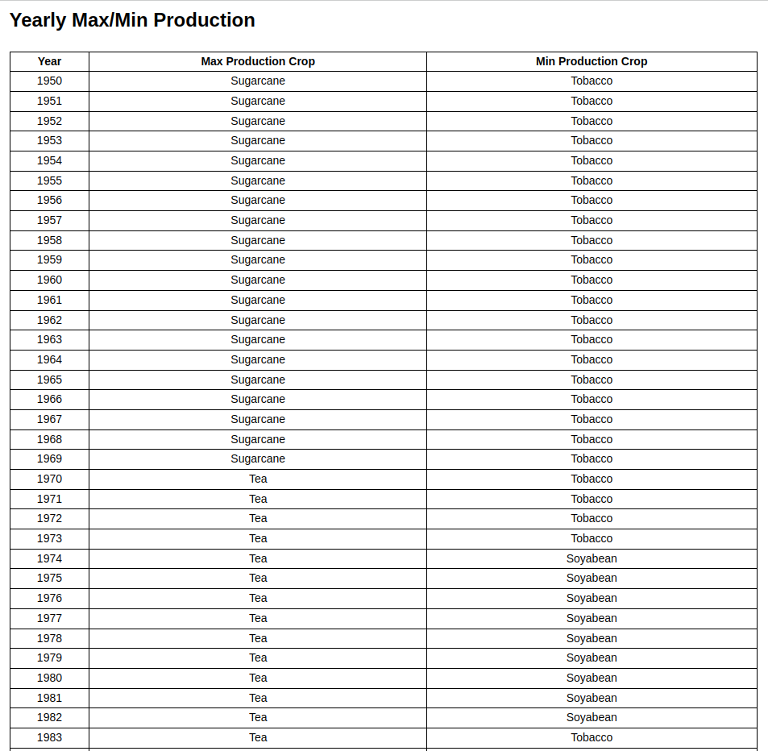
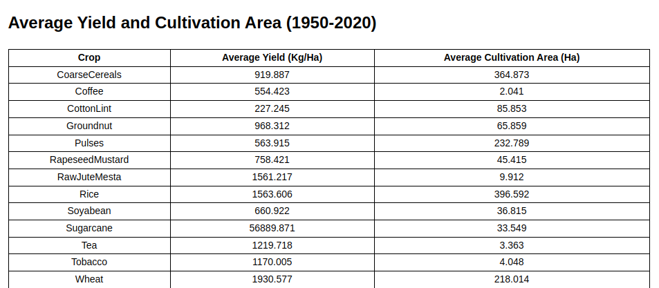

# Agriculture Analytics

A React and TypeScript app that analyses the Indian Agriculture dataset (crop production, yield and cultivation area from 1950 to 2020) and shows the results in two tables.

## Tables

1. **Yearly Max/Min Production** - for each year, the crop with the highest production and the crop with the lowest (non-zero) production.
2. **Average Yield and Cultivation Area (1950-2020)** - for each crop, the average yield (Kg/Ha) and average area under cultivation (Ha), calculated over all of that crop's records in the dataset.

### Screenshots





## Tech

React 18, TypeScript, Mantine (Container and Table components), Create React App. The calculations are in `src/data.ts` and run on the JSON file `src/indian_agriculture_data.json`. Empty values in the data are treated as 0, so they count towards the averages.

## Run locally

```
git clone https://github.com/Aalia98/Agriculture-Analytics.git
cd Agriculture-Analytics
yarn install
yarn start
```

## Known limitations

- Table styling is basic inline borders
- The test in `src/App.test.tsx` is the default Create React App example and does not test this app yet
